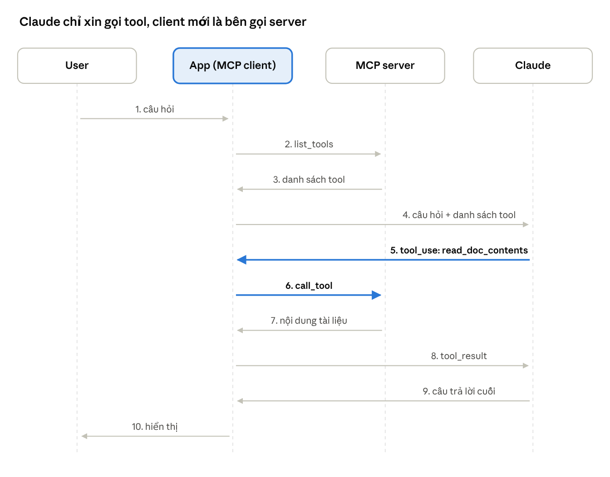

## Mở bài: ai sẽ viết 50 cái tool cho GitHub?

MCP không dạy Claude thêm kỹ năng nào. Nó chỉ trả lời một câu rất đời: **ai phải ngồi viết tool?**

Thử tưởng tượng sếp giao: "Làm con chatbot cho team, hỏi được issue, PR, repo trên GitHub nhé". Với tool use thuần, bạn phải tự viết JSON schema cho từng chức năng, tự viết hàm gọi API, tự test, tự bảo trì. GitHub có hàng chục chức năng. Tuần sau sếp đòi thêm Jira, Slack, Google Drive. Mỗi dịch vụ lại một mớ schema mới.

> **Tool use là gì?** Là tính năng của Claude API cho Claude dùng hàm do bạn viết. Bạn gửi kèm danh sách tool (tên, mô tả, JSON schema của tham số). Khi cần, Claude không tự chạy mà trả về yêu cầu `tool_use` kiểu "gọi `read_doc` với `doc_id = report.pdf`". Code của bạn chạy hàm, gửi lại `tool_result`, Claude đọc và trả lời tiếp. "Tool use thuần" là làm tất cả những việc đó bằng tay, không có MCP.

MCP đẩy phần việc đó sang **MCP server**: một gói tool viết sẵn, thường do chính nhà cung cấp dịch vụ làm. App của bạn chỉ việc cắm vào và dùng. Tool use vẫn ở đó, MCP chỉ đổi người viết tool từ bạn sang người hiểu dịch vụ nhất.

Cả 11 bài MCP trong khóa xoay quanh ý đó. Bài viết gom chúng thành năm phần: MCP là gì → dựng server và tool đầu tiên → viết client nối với Claude → resources và prompts → tổng kết và dùng thật. Cuối bài có phần dành cho ai định thi chứng chỉ Claude.

## Phần 1: MCP là gì

Ứng với hai bài đầu của khóa: Introducing MCP và MCP clients.

### MCP là cổng USB-C, client là ông môi giới

Khóa học ví MCP như **cổng USB-C cho ứng dụng AI**. Laptop không cần biết bên trong ổ cứng hay màn hình chạy ra sao, miễn cùng chuẩn cắm là chạy. Trong ví dụ này:

- **Host** là cái laptop: ứng dụng AI bạn dùng, như Claude Desktop, Claude Code, IDE, hoặc chatbot của bạn.
- **MCP client** là từng cổng cắm trên laptop: một bộ phận nằm trong host, giữ kết nối với **đúng một** server. Host cắm 3 server thì có 3 client.
- **MCP server** là thiết bị cắm vào: nó bọc một dịch vụ (GitHub, Google Calendar, thư mục file, database) và "khai" ra những gì nó làm được.

Trong project của khóa, chatbot CLI là host và class `MCPClient` là client, nên hai khái niệm dễ bị gộp làm một. Khi đọc tài liệu hoặc đi thi, nhớ tách riêng.

Cái hay bị đọc lướt: **client không chạy tool, cũng không suy nghĩ**. Claude lo phần nghĩ, server lo phần làm, client chỉ chuyển lời qua lại. Giống người quản lý dự án: không code, không ra quyết định kỹ thuật, nhưng thiếu là hai bên không nói chuyện được.

Client và server nói chuyện bằng các cặp tin nhắn hỏi–đáp theo định dạng **JSON-RPC**, ví dụ "cho xin danh sách tool" (`list_tools`) và "chạy tool này với tham số này" (`call_tool`). Trước đó hai bên chào hỏi (`initialize`) để biết bên kia hỗ trợ gì. MCP **không kén đường truyền**: cùng một máy thì dùng **stdio** (stdin/stdout), server ở xa thì dùng **Streamable HTTP**. Khóa học dùng stdio, client tự khởi động server như một tiến trình con.

> Một câu để nhớ: tool use là *cách Claude gọi tool*, MCP là *cách tool đến tay app của bạn*.

### Hiểu lầm hay gặp: MCP là "API của API"?

Đúng một nửa. MCP server của GitHub đúng là bọc GitHub API: nhận `call_tool`, gọi API thật, trả kết quả về. Nhưng câu đó sai về bản chất ở bốn chỗ:

1. **MCP là giao thức, không phải một API.** Nó là bộ luật chung quy định client và server nói với nhau câu gì. Giống HTTP không phải "một website" mà là luật để mọi website chạy.
2. **Server không nhất thiết bọc API nào.** Server trong khóa chỉ bọc một dict Python. Server cũng có thể bọc file trên máy hay database.
3. **MCP tự giới thiệu được mình.** Với API thường, lập trình viên đọc tài liệu rồi viết cứng lời gọi vào code. Với MCP, client hỏi `list_tools` là biết server có gì, lúc đang chạy.
4. **MCP có nhiều thứ hơn lời gọi hàm.** Ngoài tools còn resources (dữ liệu app tự lấy) và prompts (lệnh soạn sẵn cho user), sẽ gặp ở phần 4.

Câu chính xác hơn: **MCP là chuẩn chung để đóng gói API, dữ liệu và prompt thành dạng mà app AI cắm vào là dùng được.** Server bên trong gọi gì là việc của server.

## Phần 2: Dựng server và viết tool đầu tiên

Ứng với bài 3–5 của khóa: Project setup, Defining tools with MCP và The server inspector.

### Dựng sân chơi: một CLI chat với kho tài liệu

Khóa không bắt bạn nối GitHub thật ngay. Nó đưa một project mẫu nhỏ: chatbot chạy trong terminal, làm việc với 6 "tài liệu" nằm trong một dict Python (`deposition.md`, `report.pdf`, `financials.docx`, `outlook.pdf`, `plan.md`, `spec.txt`). Không database, không file thật. Nhờ vậy bạn chỉ tập trung vào MCP.

Điểm lạ là **client và server nằm chung một project**. Ngoài đời, bạn thường chỉ viết một trong hai. Ở đây bạn viết cả, để thấy hai bên bắt tay nhau thế nào.

```
cli_project/
├── main.py         # điểm khởi động, nối Claude + client + CLI
├── mcp_server.py   # server: tools, resources, prompts + kho tài liệu
├── mcp_client.py   # client: mở kết nối stdio tới server
└── core/           # vòng lặp chat, gọi Claude API, giao diện CLI
```

Cài đặt chỉ ba bước: điền `ANTHROPIC_API_KEY` vào file `.env`, cài thư viện (`anthropic`, `mcp[cli]`, `prompt-toolkit`, `python-dotenv`), rồi `uv run main.py`. Khóa khuyên dùng `uv`; không dùng thì đặt `USE_UV=0` và chạy bằng `python main.py`.

Lúc đầu, chatbot chỉ biết trò chuyện suông. Các phần sau lần lượt gắn cho nó tay (tools), mắt (resources) và phím tắt (prompts).

### Viết tool mà không phải đụng vào JSON schema

Nếu từng viết tool cho Claude bằng tay, bạn sẽ nhớ cái JSON schema dài ngoằng, dễ sai một dấu phẩy là hỏng. Khóa cho thấy Python SDK của MCP xóa sạch phần đó: **bạn viết hàm Python bình thường, SDK tự sinh schema**.

```python
from pydantic import Field
from mcp.server.fastmcp import FastMCP

mcp = FastMCP("DocumentMCP", log_level="ERROR")

@mcp.tool(
    name="read_doc_contents",
    description="Read the contents of a document and return it as a string.",
)
def read_document(
    doc_id: str = Field(description="Id of the document to read"),
):
    if doc_id not in docs:
        raise ValueError(f"Doc with id {doc_id} not found")
    return docs[doc_id]
```

Bốn mảnh ghép lại thành một tool:

1. `@mcp.tool` đánh dấu hàm này là tool, kèm tên và mô tả cho Claude đọc.
2. Type hint (`doc_id: str`) cho biết kiểu dữ liệu.
3. `Field(description=...)` giải thích ý nghĩa từng tham số. Đây là chỗ Claude dựa vào để điền tham số cho đúng, nên đừng viết qua loa.
4. `raise ValueError` khi đầu vào sai. Lỗi này được trả về cho Claude, và Claude thường tự sửa rồi gọi lại.

Tool thứ hai, `edit_document`, nhận `doc_id`, `old_str`, `new_str` và thay chuỗi trong tài liệu. Nó kiểm tra tài liệu có tồn tại không trước khi sửa. Thiết kế "tìm và thay" này không ngẫu nhiên: sửa một đoạn nhỏ an toàn hơn nhiều so với bắt Claude viết lại cả tài liệu.

### MCP Inspector: test server trước khi gọi Claude

Viết xong tool, phản xạ tự nhiên là nối ngay với Claude để thử. Đừng. Nếu kết quả sai, bạn sẽ không biết lỗi nằm ở tool, ở client, hay ở cách Claude hiểu mô tả.

Khóa giới thiệu **MCP Inspector**, một "client giả" chạy trên trình duyệt:

```bash
mcp dev mcp_server.py
```

Lệnh này khởi động server và in ra một địa chỉ localhost. Mở ra, bấm **Connect**, vào tab **Tools**, chọn `read_doc_contents`, gõ `deposition.md`, bấm **Run Tool**. Kết quả hiện ra đúng như những gì Claude sẽ nhận.

Thử thêm một mẹo: gọi `edit_document` để sửa một tài liệu, rồi gọi `read_doc_contents` để đọc lại. Thấy chữ đã đổi nghĩa là server giữ được trạng thái giữa các lần gọi.

Inspector còn có tab **Resources** và **Prompts**, nên mỗi khi thêm tính năng mới ở các phần sau, bạn cũng quay lại đây test trước. Quy tắc rút ra: **test server một mình trước, rồi mới ghép với AI**.

## Phần 3: Viết client và nối với Claude

Ứng với bài 6 của khóa: Implementing a client.

Phần lớn bài viết về MCP chỉ nói chuyện server. Khóa này lại để bạn tự viết client, và đây là lúc nhiều thứ "à ra thế". Khóa bọc toàn bộ việc kết nối vào một class `MCPClient`:

```python
class MCPClient:
    async def connect(self):
        params = StdioServerParameters(command="uv", args=["run", "mcp_server.py"])
        read, write = await self._exit_stack.enter_async_context(stdio_client(params))
        self._session = await self._exit_stack.enter_async_context(ClientSession(read, write))
        await self._session.initialize()

    async def list_tools(self):
        result = await self.session().list_tools()
        return result.tools

    async def call_tool(self, tool_name, tool_input):
        return await self.session().call_tool(tool_name, tool_input)
```

Ba điều đáng ghi lại:

- **`ClientSession` là đường dây điện thoại** giữa app và server. Mở ra thì phải cúp máy: `AsyncExitStack` và `async with` lo việc đóng kết nối khi app tắt.
- **Mọi thứ đều là async**. Gọi server phải `await`, nếu không app đứng hình trong lúc chờ.
- **Client có thể chạy riêng để thử**. File `mcp_client.py` có sẵn một hàm `main()` in ra danh sách tool. In ra được là đường ống thông, chưa cần tới Claude.

Khi ghép vào chatbot, một câu hỏi của user đi qua đúng một vòng như hình dưới. Điểm mấu chốt: client chuyển danh sách tool của server sang đúng định dạng tool của Claude API (`name`, `description`, `input_schema`). Nên nhìn từ phía Claude, tool MCP và tool tự viết không khác gì nhau.



Hai mũi tên đậm là chỗ hay hiểu nhầm: Claude chỉ trả về yêu cầu `tool_use`, còn client mới là bên gọi `call_tool` tới server.

## Phần 4: Resources và prompts

Ứng với bài 7–10 của khóa. Tool là thứ Claude tự gọi; hai primitive còn lại do app và user điều khiển.

### Resources: khi app cần dữ liệu mà không muốn hỏi Claude

Thử gõ vào CLI: `Tóm tắt giúp tôi @report.pdf`. Nếu chỉ có tools, Claude phải tự quyết định gọi `read_doc_contents`, chờ kết quả, rồi mới tóm tắt. Tốn thêm một vòng gọi API chỉ để đọc một file mà user đã chỉ đích danh.

**Resource** giải bài toán này. Nó là dữ liệu server cung cấp, nhưng **người lấy là code của app**, không phải Claude. App tự đọc nội dung rồi nhét thẳng vào prompt. Khóa làm hai loại:

```python
@mcp.resource("docs://documents", mime_type="application/json")
def list_docs() -> list[str]:
    return list(docs.keys())          # resource tĩnh: danh sách tài liệu

@mcp.resource("docs://documents/{doc_id}", mime_type="text/plain")
def fetch_doc(doc_id: str) -> str:
    return docs[doc_id]               # resource mẫu: {doc_id} thành tham số hàm
```

Resource tĩnh (`docs://documents`) dùng để hiện danh sách gợi ý khi user gõ `@`. Resource mẫu (`docs://documents/{doc_id}`) lấy nội dung một tài liệu. URI trông như đường dẫn web, và bạn tự đặt ra theo ý mình.

Ở phía client, chỉ một hàm `read_resource`, và cái bẫy nằm ở **MIME type**. Server luôn trả về chuỗi, kèm nhãn cho biết đó là gì:

```python
async def read_resource(self, uri: str):
    result = await self.session().read_resource(AnyUrl(uri))
    resource = result.contents[0]
    if resource.mimeType == "application/json":
        return json.loads(resource.text)   # danh sách → list Python
    return resource.text                   # văn bản → giữ nguyên
```

Quên đặt `mime_type` ở server hoặc quên kiểm tra ở client, bạn sẽ nhận về một chuỗi `'["deposition.md", ...]'` thay vì một list. Lỗi nhỏ, nhưng mất cả buổi để tìm.

### Prompts: để user không phải làm prompt engineer

User có thể gõ "định dạng lại plan.md bằng markdown" và Claude vẫn làm được. Nhưng kết quả phụ thuộc vào cách họ hỏi. Người viết server hiểu dữ liệu của mình hơn ai hết, nên họ nên viết sẵn prompt tốt nhất rồi đưa cho user dùng. Đó là **MCP prompt**.

```python
from mcp.server.fastmcp.prompts import base

@mcp.prompt(name="format", description="Rewrites the contents of the document in Markdown format.")
def format_document(doc_id: str = Field(description="Id of the document to format")) -> list[base.Message]:
    prompt = f"""
    Your goal is to reformat a document to be written with markdown syntax.
    The id of the document you need to reformat is:
    <document_id>{doc_id}</document_id>
    Add in headers, bullet points, tables, etc as necessary.
    Use the 'edit_document' tool to edit the document.
    """
    return [base.UserMessage(prompt)]
```

Hàm này **không gọi Claude**. Nó chỉ trả về một danh sách tin nhắn đã điền sẵn `doc_id`. Giống trò điền từ vào chỗ trống: server soạn khung, user điền chỗ trống, Claude đọc bản hoàn chỉnh.

Ở phía client, `list_prompts()` cho biết có những prompt nào để hiện thành lệnh `/format`, `/summarize`. Khi user gõ `/format plan.md`, client gọi `get_prompt("format", {"doc_id": "plan.md"})`, nhận về tin nhắn, đổi sang định dạng của Claude API rồi gửi đi.

Chú ý prompt trên bảo Claude dùng tool `edit_document`. Đây là lúc ba thứ gặp nhau: user bấm lệnh (prompt), Claude tự gọi tool để sửa (tool), app đọc tài liệu để hiển thị (resource).

## Phần 5: Tổng kết và mang ra dùng thật

Ứng với bài 11 của khóa (MCP review), cộng thêm những gì khóa chưa nói.

### Chọn đúng primitive chỉ bằng một câu hỏi

Bài ôn tập cuối khóa gói mọi thứ lại trong một câu hỏi: **ai là người bấm nút?** Trả lời được câu này là biết nên viết tool, resource hay prompt.

|  | Tools | Resources | Prompts |
| --- | --- | --- | --- |
| Ai điều khiển | Claude (model) | Code của app | User |
| Câu hỏi gợi ý | Claude cần thêm khả năng gì? | App cần dữ liệu gì để hiển thị hoặc nhét vào prompt? | User hay làm lại việc gì? |
| Decorator ở server | `@mcp.tool` | `@mcp.resource` | `@mcp.prompt` |
| Gọi từ client | `list_tools`, `call_tool` | `read_resource` | `list_prompts`, `get_prompt` |
| Trong project mẫu | `read_doc_contents`, `edit_document` | `@report.pdf`, danh sách tài liệu | `/format`, `/summarize` |
| Ngoài đời thật | Tạo issue GitHub, chạy truy vấn | Danh sách file Google Drive | Nút "Tóm tắt" trong Claude Desktop |

Quy trình làm việc cũng được chốt thành bốn bước: viết hàm với decorator → test bằng `mcp dev` → viết client → nối với Claude.

### Ngoài khóa học: cắm server thật vào dùng

Khóa dạy bạn tự viết cả hai đầu. Ngoài đời, bạn thường chỉ cắm server có sẵn vào một host như Claude Code hay Claude Desktop, và host lo hết phần client.

Với Claude Code, một lệnh là xong:

Server cục bộ (stdio), mọi thứ sau `--` là lệnh khởi động server:

```bash
claude mcp add documents -- uv run mcp_server.py
```

Server ở xa (Streamable HTTP), dùng chung cho cả team:

```bash
claude mcp add --transport http --scope project github https://api.githubcopilot.com/mcp/
```

`--scope project` ghi cấu hình vào file `.mcp.json` ở gốc project. File này được commit lên git nên cả team dùng chung. Không ghi scope thì server chỉ có trên máy bạn.

```json
{
  "mcpServers": {
    "github": {
      "type": "http",
      "url": "https://api.githubcopilot.com/mcp/",
      "headers": { "Authorization": "Bearer ${GITHUB_TOKEN}" }
    }
  }
}
```

Chú ý `${GITHUB_TOKEN}`: token lấy từ biến môi trường lúc chạy, **không bao giờ ghi thẳng vào file** đã commit.

Ba điều về an toàn mà khóa chưa nói:

- **Server chạy code thật.** Server stdio chạy ngay trên máy bạn với quyền của bạn. Chỉ cài server từ nguồn tin cậy, như khi cài một app.
- **Mô tả tool và kết quả tool đi thẳng vào ngữ cảnh của Claude.** Một server xấu, hoặc một trang web mà tool đọc về, có thể chèn chỉ dẫn lạ. Đây là lý do host thường hỏi bạn trước khi cho gọi tool.
- **Không cắm quá nhiều server cùng lúc.** Mỗi tool tốn một ít ngữ cảnh, và nhiều tool na ná nhau khiến Claude dễ chọn nhầm.

Các tính năng nâng cao hơn (sampling, notifications, roots) nằm trong khóa MCP Advanced Topics của Anthropic, không thuộc 11 bài này.

### Học xong thì mang về được gì

Nếu chỉ nhớ một điều: **MCP là chuyện phân vai**. Server lo viết tool, app lo nối và hiển thị, Claude lo suy nghĩ, user lo ra lệnh. Mỗi bên chỉ cần giỏi phần của mình.

Năm cái bẫy dễ vấp khi tự làm:

1. **Mô tả tool và tham số qua loa.** Claude chỉ biết tool qua `description` và `Field`. Mô tả mơ hồ thì Claude dùng sai.
2. **Nhảy thẳng sang Claude mà bỏ qua Inspector.** Lỗi trộn ba tầng (server, client, model) rất khó lần.
3. **Dùng tool cho mọi thứ.** Dữ liệu mà app đã biết cần gì thì để resource lấy, đừng bắt Claude gọi tool cho tốn một vòng.
4. **Quên MIME type.** JSON về tay thành chuỗi và mọi thứ phía sau hỏng theo.
5. **Quên đóng kết nối.** Thiếu `async with` hoặc `cleanup()`, tiến trình server có thể còn treo sau khi app tắt.

Bài tập tự giao để chắc tay: viết thêm prompt `/summarize` (khóa để lại như một TODO), rồi thử nối một MCP server có sẵn vào Claude Desktop. Lúc đó bạn sẽ thấy phần client mình viết tay cả buổi chính là thứ Claude Desktop đang làm sẵn.

## Nếu bạn định thi chứng chỉ Claude

MCP nằm chủ yếu trong kỳ thi **Claude Certified Architect – Foundations (CCAR-F)**, ở mảng "Tool Design & MCP Integration", chiếm **18%** đề. Thông tin dưới đây lấy từ các tài liệu ôn thi không chính thức, dựa trên Exam Guide v1.0 (7/2026). Hãy đối chiếu với bản chính thức của Anthropic trước khi đăng ký.

| Mục | Chi tiết |
| --- | --- |
| Hình thức | 60 câu trắc nghiệm theo tình huống, 120 phút, không được xem tài liệu, có giám sát |
| Điểm đỗ | 720/1000 |
| Lệ phí | 125 USD mỗi lần thi |
| Hiệu lực | 12 tháng |
| Ai được thi | Người làm ở tổ chức thuộc Claude Partner Network, đăng ký bằng email công ty |

Năm mảng của đề và tỉ trọng:

| Mảng | Tỉ trọng |
| --- | --- |
| Agentic Architecture & Orchestration | 27% |
| Claude Code Configuration & Workflows | 20% |
| Prompt Engineering & Structured Output | 20% |
| Tool Design & MCP Integration | 18% |
| Context Management & Reliability | 15% |

### Phần MCP cần nhớ

Đề thi không hỏi cú pháp `@mcp.tool`. Nó hỏi bạn **thiết kế đúng** khi đứng trước một tình huống. Bảy ý sau gần như chắc chắn gặp:

1. **Mô tả tool là thứ Claude dùng để chọn tool.** Mô tả tốt nói rõ: làm gì, khi nào dùng, đầu vào, đầu ra, khác tool gần giống ở đâu. Hai tool mô tả na ná nhau thì đổi tên cho rõ hoặc gộp lại (nối tiếp mục viết tool ở phần 2).
2. **Lỗi phải có cấu trúc.** Trả về `isError: true` kèm loại lỗi và có nên thử lại hay không. Bốn loại hay gặp: lỗi tạm thời (timeout, thử lại được), sai đầu vào (sửa rồi thử lại), vi phạm quy tắc nghiệp vụ (báo user), thiếu quyền (chuyển cho người).
3. **"Không có kết quả" khác "không tìm được".** Trả `[]` khi database đang sập là đáp án sai kinh điển, vì agent sẽ tự tin báo "không có gì".
4. **Mỗi agent chỉ nên cầm khoảng 4–5 tool.** Nhiều hơn thì chia cho các subagent chuyên biệt, hoặc dùng tool search để chỉ nạp tool khi cần.
5. **`tool_choice` có bốn kiểu:** `auto` (Claude tự quyết), `any` (bắt buộc gọi một tool bất kỳ), chỉ định một tool cụ thể, và `none` (chỉ trả lời bằng chữ). Đề hỏi khái niệm. Khi code thật, kiểm tra model bạn dùng còn hỗ trợ kiểu ép gọi tool không.
6. **Kiến trúc và đường truyền.** Host chứa nhiều client, mỗi client nối đúng một server. Tin nhắn theo JSON-RPC. stdio cho server cục bộ, Streamable HTTP cho server ở xa. Ba primitive và người điều khiển từng loại (phần 5).
7. **Cấu hình trong Claude Code.** `.mcp.json` là cấu hình dùng chung cho cả team (commit lên git), còn cấu hình riêng nằm ở `~/.claude.json`. Bí mật luôn đi qua `${BIEN_MOI_TRUONG}`.

### Thử một câu kiểu đề thi

Câu này mình tự soạn theo dạng đề, không phải câu thật.

> Agent chăm sóc khách hàng có tool `search_orders`. Database bị timeout, tool trả về `{"results": []}`. Agent trả lời khách: "Bạn chưa có đơn hàng nào". Cách sửa tốt nhất là gì?
>
> - A. Thêm vào system prompt: "Đừng tin kết quả rỗng"
> - B. Cho tool trả về `isError: true`, ghi rõ lỗi tạm thời và có thể thử lại
> - C. Tăng thời gian timeout của database
> - D. Đổi sang model lớn hơn

Đáp án: **B**. A và D để model đoán mò, C chỉ giảm tần suất chứ không sửa gốc. Đề thật thường giăng bẫy đúng kiểu này: đáp án đúng sửa ở thiết kế tool, không phải ở prompt hay model.

Ôn theo thứ tự: đọc lại phần 2 đến phần 5 của bài này, rồi đọc Exam Guide chính thức, cuối cùng làm đề thử. MCP chỉ là 18%, nên đừng bỏ quên bốn mảng còn lại.

## Nguồn

- [Introducing MCP, Building with the Claude API](https://academy.claude.com/courses/building-with-the-claude-api/introducing-mcp) (Claude Academy).
- [jaygaha/claude-mcp-course](https://github.com/jaygaha/claude-mcp-course): ghi chép từng bài và code project `cli_project_mcp` của một học viên. Phần code trong bài này lấy từ đây, có rút gọn.
- [dnacenta/claude-certified-architect](https://github.com/dnacenta/claude-certified-architect): tài liệu ôn thi CCAR-F không chính thức (cập nhật 14/10/2026), nguồn cho hình thức thi, tỉ trọng và nội dung mảng MCP.
- [The Claude Certified Architect Exam: 5 Domains, 6 Scenarios](https://dev.to/aws-builders/the-claude-certified-architect-exam-5-domains-6-scenarios-and-everything-you-need-to-know-4le3) và [CCAR-F Study Guide](https://tutorialsdojo.com/ccar-f-claude-certified-architect-foundations-study-guide/): đối chiếu tỉ trọng các mảng.
